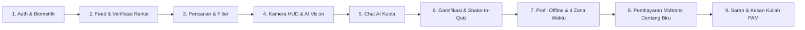

# Panduan Skenario Demo & Laporan Akhir (Sesi S24) — Faunova

Dokumen ini merupakan panduan komprehensif skenario demonstrasi aplikasi dan referensi tangkapan layar (*screenshot*) untuk penyusunan Laporan Akhir Praktikum Pemrograman Aplikasi Mobile (PAM), sesuai target **Scope S24** dan kriteria evaluasi dosen.

---

## 1. Katalog Data Demo Tersedia

Faunova dilengkapi data kurasi riset biodiversitas Indonesia yang siap dipakai saat pengujian luring (*offline / demo mode*) maupun daring (*Supabase backend*).

### A. Akun Peneliti & Kolektor Komunitas
| Username | Nama Lengkap | Status Verifikasi | Spesialisasi Observasi |
|---|---|---|---|
| `arya_wallacea` | Arya Wicaksana | Centang Biru (Aktif) | Fauna Wallacea & Mamalia Nusa Tenggara |
| `wayan_bali` | Wayan Sukadana | Centang Biru (Aktif) | Aves & Konservasi Jalak Bali |
| `siti_badak` | Dr. Siti Rahmawati | Centang Biru (Aktif) | Mamalia Besar & Ujung Kulon |
| `faiz_ocean` | Faiz Alamsyah | Centang Biru (Aktif) | Biota Laut, Penyu Hijau & Hiu Paus |
| `dewi_papua` | Dewi Lestari | Reguler | Avifauna Paradisaea & Kasuari Papua |
| `borneo_wildlife` | Budi Alamsyah | Reguler | Primata Endemik & Hutan Hujan Kalimantan |

### B. Bank Soal Kuis Biologi Satwa Liar (12 Soal Teruji)
Seluruh soal dirancang berbasis sains riil biodiversitas Nusantara (Plan 5.8 & S13):
1. **Aves (Jalak Bali)**: Burung endemik Bali Barat berbulu putih dengan topeng biru di mata.
2. **Reptilia (Komodo)**: Organ Jacobson pada lidah bercabang untuk deteksi partikel aroma.
3. **Mamalia (Orangutan Sumatera)**: Perbedaan morfologis bulu lebih panjang/jingga terang dibanding Kalimantan.
4. **Biogeografi (Garis Wallace)**: Pemisahan fauna tipe Asiatis dan Peralihan.
5. **Mamalia (Anoa)**: Bovid liar terkecil di dunia endemik Pulau Sulawesi.
6. **Aves (Maleo Senkawor)**: Peneluran mengandalkan pasir bersuhu panas bumi (geotermal).
7. **Mamalia (Badak Jawa)**: Karakteristik cula tunggal (*monoceros*) vs cula ganda Badak Sumatera.
8. **Konservasi (IUCN Red List)**: Kategori *Critically Endangered (CR)* untuk risiko kepunahan amat tinggi.
9. **Mamalia (Bekantan)**: Monyet hidung panjang endemik hutan bakau Kalimantan.
10. **Reptilia (Kura-kura Leher Ular Rote)**: Lipatan leher ke samping (*subordo Pleurodira*).
11. **Mamalia (Harimau Sumatera)**: Adaptasi tubuh ramping dan loreng rapat di vegetasi lebat.
12. **Amfibi (Katak Pohon Mutiara)**: Bintik-bintik putih menyerupai mutiara di punggung.

### C. Jurnal Tangkapan Satwa Lapangan & Hash-Chain
Data tangkapan memuat foto satwa beresolusi tinggi, nama ilmiah taksonomi, status konservasi IUCN, koordinat grid snapping 0.01°, arah kompas (*heading*), dan rantai hash kriptografi SHA-256 kanonis (`prev_hash` -> `block_hash`).

---

## 2. Naskah Skenario Demo Walkthrough (End-to-End)

Urutan demonstrasi berikut disusun secara logis dari alur pertama kali membuka aplikasi hingga fitur lanjutan, dapat dipraktikkan langsung dalam waktu 5–7 menit saat presentasi di hadapan Dosen/Asisten Laboratorium.

---

### Langkah 1: Autentikasi Pengguna & Kunci Biometrik (S2, S17, S23)
1. Buka aplikasi Faunova.
2. Tunjukkan layar **Masuk (Login)** dengan tema palet natural (*sage tua, gading, emas*).
3. Demonstrasikan validasi formulir (input email tidak valid atau sandi kosong).
4. Masuk ke akun atau gunakan tombol **Mode Demo** untuk presentasi kilat instan tanpa internet.
5. Saat aplikasi dikunci kembali, demonstrasikan **BiometricLockPage**:
   - Pindai sidik jari perangkat untuk langsung membuka aplikasi.
   - Atau gunakan tombol *Gunakan Kata Sandi* sebagai fallback saat sensor biometrik terkunci.

---

### Langkah 2: Beranda Sosial & Verifikasi Rantai Kriptografi (S1, S8, S9, S10)
1. Tunjukkan beranda dengan navigasi **Bottom Bar Kaca Frosted** (`sigma 25`) dan kapsul meluncur halus (*sliding pill indicator*).
2. Perlihatkan dua tab: **Untuk Kamu** dan **Mengikuti**.
3. Jelaskan kartu jurnal lapangan:
   - Nama spesies satwa (*Jalak Bali, Casuarius casuarius, Chelonia mydas*).
   - Status konservasi IUCN (*Kritis / CR, Terancam / EN*).
   - Lokasi kasar hasil *grid snapping server 0.01°* (koordinat presisi aman, tidak bocor ke publik sesuai aturan `AGENTS.md`).
4. Ketuk tombol **Verifikasi Rantai** pada salah satu kartu postingan:
   - Tunjukkan dialog verifikasi SHA-256 yang memvalidasi `photo_sha256`, `prev_hash`, dan `block_hash`.
   - Tunjukkan status `Valid (Rantai Utuh)` berwarna hijau sage.

---

### Langkah 3: Penjelajahan & Pencarian Satwa (S11, S20)
1. Beralih ke tab **Cari**.
2. Tunjukkan filter taksonomi horizontal (*Mamalia, Aves, Reptilia, Amfibi*).
3. Cari kata kunci spesies (misal: "Harimau" atau "Bali").
4. Jelaskan prioritas pencarian: Akun yang memiliki langganan **Centang Biru** secara otomatis diprioritaskan di urutan paling atas dengan lencana resmi emas/biru.

---

### Langkah 4: Kamera Pengamatan Lapangan & AI Gateway (S4, S5)
1. Beralih ke tab tengah **Kamera**.
2. Tunjukkan antarmuka HUD optik taktis:
   - Crosshair reticle pembidik tengah.
   - Pita kompas magnetometer (*live heading*, misal `148° SE`).
   - Indikator akurasi GPS dan grid 0.01°.
3. Ambil bidikan foto satwa:
   - Foto dikompresi di memori klien dan dianalisis melalui Edge Function `ai-gateway` (Google Gemini 2.0 Flash / Cloudflare / DeepSeek fallback).
   - Tunjukkan hasil identifikasi taksonomi, nama ilmiah, status konservasi, dan deskripsi biologi.
4. Tunjukkan mekanisme proteksi: Foto objek bukan hewan (meja, buku, benda mati) ditolak oleh sistem AI dan tidak dapat disimpan ke koleksi atau dibagikan ke feed.

---

### Langkah 5: Tanya-Jawab Chat AI Satwa Lapangan (S6, S20)
1. Dari halaman hasil observasi kamera, ketuk tombol **Tanya AI Satwa**.
2. Ajukan pertanyaan interaktif konservasi (misal: "Apa habitat utama satwa ini di Indonesia?").
3. Perlihatkan balasan cerdas terarah dari AI mengenai biologi dan pelestarian.
4. Tunjukkan indikator kuota percakapan atomik di pojok atas:
   - Pengguna reguler: kuota 5 pertanyaan.
   - Pengguna terverifikasi Centang Biru: kuota otomatis meningkat menjadi 10 pertanyaan (Plan 125).

---

### Langkah 6: Arena Gamifikasi Satwa & Shake-to-Quiz (S13, S14, S15, S16)
1. Beralih ke tab **Game**.
2. Perlihatkan tiket **Streak Harian**:
   - Ketuk untuk check-in dan klaim penambahan streak hari ini.
   - Tunjukkan bahwa klaim kedua di hari yang sama ditolak (idempoten).
3. Perlihatkan kartu **Tantangan Hari Ini** dengan satu soal biologi khusus berhadiah +50 poin.
4. Demonstrasikan **Shake-to-Quiz** (Guncang HP):
   - Goyangkan perangkat fisik (atau ketuk tombol simulasi guncang accelerometer).
   - Soal kuis acak seketika muncul dengan dialog interaktif.
   - Tunjukkan batas kuota harian 3x per hari yang ditegakkan server.
5. Masuk ke **Arena Kuis 10 Soal**:
   - Tunjukkan timer mundur dinamis per soal, nyawa hati merah, dan pengganda kombo bonus.
   - Tekankan aturan keamanan: kunci jawaban tidak pernah dikirim ke klien, seluruh skor dihitung ulang di server Postgres.
   - Di akhir kuis, tunjukkan ringkasan skor dan pembukaan **Lencana Prestasi (Badges)** baru.

---

### Langkah 7: Profil Kolektor, Cache Offline, & 4 Zona Waktu (S11, S12)
1. Beralih ke tab **Profil**.
2. Tunjukkan portofolio kolektor: foto avatar satwa, bio riset, total observasi, lencana yang diraih.
3. Tunjukkan kartu **Waktu Observasi Lapangan (4 Zona Waktu)**:
   - Waktu Indonesia Barat (WIB / UTC+7).
   - Waktu Indonesia Tengah (WITA / UTC+8).
   - Waktu Indonesia Timur (WIT / UTC+9).
   - Waktu Referensi London (GMT / UTC+0).
   - Dilengkapi indikator perbedaan jam real-time.
4. Tunjukkan ketahanan luring (*Offline Mode*):
   - Putuskan koneksi internet / nyalakan Mode Pesawat.
   - Koleksi satwa dan setting tetap terbuka seketika dari database lokal **Hive terenkripsi AES-256** (`HiveAesCipher`) yang kuncinya disimpan di `FlutterSecureStorage`.
5. Ketuk tombol **Periksa Integritas Rantai SHA-256** di bagian bawah profil untuk memverifikasi seluruh blok tangkapan kolektor dari blok genesis.

---

### Langkah 8: Pembayaran Midtrans Sandbox & Centang Biru (S19, S20)
1. Di profil, ketuk banner atau tombol **Dapatkan Centang Biru**.
2. Tunjukkan lembar modal **UpgradeBlueCheckSheet**:
   - Harga resmi: **Rp 15.000 / bulan**.
   - Konversi multi-mata uang otomatis dari cache kurs terenkripsi (**USD \$0.95**, **JPY ¥145**).
   - Tiga keunggulan eksklusif: Lencana Centang Biru, Kuota Chat AI 10 Pertanyaan, dan Prioritas Pencarian.
3. Ketuk tombol **Bayar**:
   - Membuka **MidtransSnapWebViewPage** (simulator sandbox Snap).
   - Simulasikan pembayaran berhasil (settlement).
   - Verifikasi bahwa webhook signature diproses aman di Edge Function, `verified_until` bertambah +30 hari kumulatif, dan lencana Centang Biru seketika aktif di profil!
4. Buka tab **Riwayat Pembayaran**:
   - Tampilkan baris transaksi resmi dengan nomor order `FAUNOVA-CB-...`, nominal Rp15.000, dan badge status *Berhasil*.

---

### Langkah 9: Saran & Kesan Kuliah PAM & Pengaturan Aplikasi (S21)
1. Di tab Profil, ketuk tombol menu titik tiga (`...`) di pojok kanan atas.
2. Pilih menu **Saran & Kesan Kuliah PAM**:
   - Tunjukkan banner penghargaan mata kuliah Teori Pemrograman Aplikasi Mobile (PAM).
   - Tampilkan kartu profil 3 anggota tim mahasiswa (NIM, Nama, Peran).
   - Tampilkan nilai harapan untuk mata kuliah (Grade A).
   - Perlihatkan kolom formulir pesan, kesan, dan saran untuk Dosen & Asisten Laboratorium dengan validasi input dan penyimpanan riwayat lokal.
3. Buka menu **Pengaturan Aplikasi (AppSettingsSheet)**:
   - Toggle sakelar Kunci Biometrik.
   - Pengaturan notifikasi pengingat streak (19:00 WIB), tantangan harian (08:00 WIB), dan masa aktif Centang Biru (H-3).
   - Informasi versi build aplikasi dan hak cipta.

---

## 3. Daftar Titik Layar (*Screenshot*) untuk Laporan Akhir

Untuk melengkapi Bab Implementasi Antarmuka pada Laporan Akhir PAM, berikut daftar 12 tangkapan layar yang dianjurkan untuk diambil dari perangkat fisik:

| No | Nama Layar | Deskripsi Konten untuk Laporan |
|---|---|---|
| 1 | `01_login_and_auth.png` | Layar masuk dengan palet warna natural, tombol emas, dan banner mode demo |
| 2 | `02_biometric_lock.png` | Layar Kunci Biometrik dengan ikon sensor fingerprint dan opsi sandi fallback |
| 3 | `03_feed_untuk_kamu.png` | Beranda sosial menampilkan kartu satwa, lencana IUCN, dan glass bottom bar |
| 4 | `04_verify_chain_dialog.png` | Dialog pembuktian integritas kriptografi SHA-256 per blok tangkapan |
| 5 | `05_search_priority.png` | Pencarian taksonomi dengan akun Centang Biru berada di prioritas teratas |
| 6 | `06_camera_hud.png` | Viewfinder optik taktis kamera dengan pita kompas arah dan crosshair |
| 7 | `07_ai_chat_quota.png` | Sesi tanya-jawab AI interaktif satwa dengan kuota 10 pertanyaan |
| 8 | `08_game_arena_quiz.png` | Arena kuis biologi satwa liar dengan timer mundur, nyawa hati, dan kombo |
| 9 | `09_shake_to_quiz.png` | Pop-up guncang HP (accelerometer) dengan kuota 3x per hari |
| 10 | `10_profile_multitimezone.png` | Profil kolektor satwa dan kartu jam konversi 4 zona waktu (WIB, WITA, WIT, GMT) |
| 11 | `11_midtrans_payment.png` | Modal upgrade Centang Biru dengan kurs 3 mata uang (IDR, USD, JPY) dan riwayat |
| 12 | `12_saran_kesan_pam.png` | Layar Saran & Kesan Kuliah PAM menampilkan profil 3 mahasiswa dan nilai harapan A |

---

## 4. Checklist Kesiapan Demo Dosen

- [x] Rangkaian uji otomatis `flutter test` lulus 100% (122 dari 122 pengujian berhasil).
- [x] Analisis statis `flutter analyze` 0 issues (bersih dari warning dan error).
- [x] Mode offline/demo berfungsi mandiri saat perangkat tidak terhubung ke internet.
- [x] Kunci rahasia server (Gemini, Midtrans, Service Role) terisolasi penuh di Supabase Edge Functions.
- [x] Seluruh antarmuka berbahasa Indonesia yang konsisten, santun, dan komunikatif.
